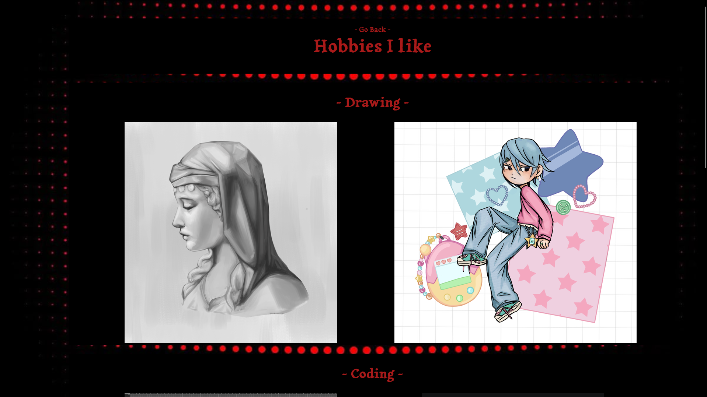
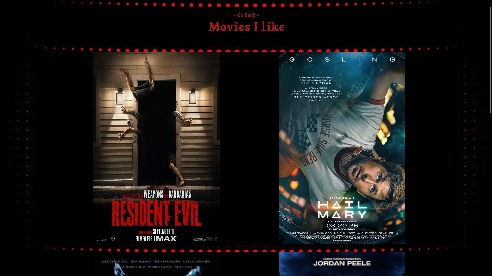

# MyintWebsite
Personal website made with html and css.
## Description:

A website with a bento box style about me and things that i like. You can click links and got to the designated pages. there are a amount of 10 pages you can go to and the link on the right go to websites from my wish list. This website is done with HTML and CSS in VScode studio. 

## Screenshots:

- image for index.html, hobbies.html, and movies.html 
images are from the new updated website.

## How to use it:

You can press this link to deploy the website or download it and open it in your browser.  
Link for the website: https://3amstudiosgames-commits.github.io/MyintWebsite/  
For downloading just download this repo and you are going to have everything necessary to open it.

## Dependencies:
This website doesn't need any dependencies.  
Any new computers should be able to install or open the website.
## Installing/Using
install the repo and open any of the html if you want to see the pages.
for other information go to how to use.
## Help:
This website doesn't have any known bugs.
If there are bugs it is a code problem, but everything should run smoothly.
## Other info:
Images are from the internet except the coding/drawing ones. This website is done for a hack club program called Pixl.  
This is my second time doing a website.  
For any coding help i used: GeeksforGeeks and Youtube.
